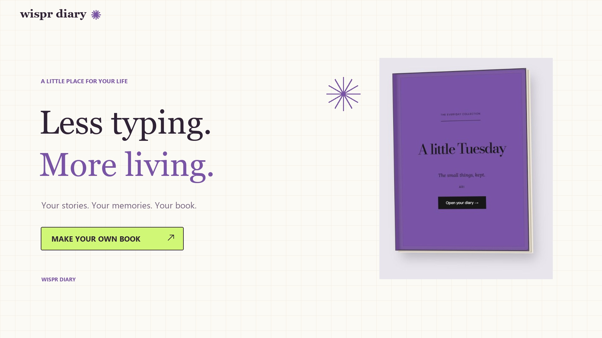

# Wispr Diary

**A little less typing. A little more living.**

A diary should feel like a place to return to, not another document to finish. Wispr Diary turns your everyday stories into a book you can open, personalize, and fill with words, pictures, sticky notes, and memories you can actually hear.

Built for the Wispr Flow no-hands challenge, with voice at the center and typing always available.

[Explore the website](https://wispr-diary.vercel.app/) · [Watch the narrated demo](https://wispr-diary.vercel.app/demo.html) · [Set up authentication](AUTH-SETUP.md)

## A minute inside the book

[](docs/media/wispr-diary-promo.mp4)

**[▶ Watch the 63-second promo](docs/media/wispr-diary-promo.mp4)** · [Transcript](docs/media/transcript.md) · [Captions](docs/media/captions.vtt)

The 1080p walkthrough uses fictional memories and scripted interactions, with a conversational voice generated locally using Kokoro. It does not represent a live Wispr API recording.

## What you can do

- **Open a real-feeling book.** Closed covers, a roomy reading view, page turns, and fullscreen journaling.
- **Make several books your own.** Choose a title, cover, category, paper color, and lined or blank pages.
- **Write or speak your day.** See text appear in the book, with automatic pagination as your story grows.
- **Keep more than words.** Place sticky notes, photos, video clips, audio files, and paper scraps on the pages. Move keepsakes using their drag handles while keeping their text editable.
- **Return to your account library.** Supabase provides email/Google sign-in and per-account book storage with row-level security.
- **Try before signing in.** A read-only sample shows the possibilities. “Make your own book” starts your personal copy from a clean book, with a short optional tutorial.
- **Stay in the book.** Compact controls keep the pages in focus. Typed requests and manual controls remain available alongside voice.

## Voice, honestly

The public static deployment supports browser dictation in compatible browsers and the app's local command interpreter. Microphone support depends on the browser, permissions, and its speech service; typing works as a fallback.

The project also includes two optional server-side adapters:

- **Wispr transcription:** prepared for an approved Wispr API key. It is not enabled in the public release, and visitors do not need the desktop Flow app to use the available browser microphone.
- **AI intent interpretation:** optional natural-language requests through a configured AI API. Without API credentials/credits, the local command interpreter remains available; unrestricted language understanding is not active.

The Vercel deployment intentionally reports those optional services as unconfigured. Deploying the static site does not deploy the local Python API server or enable paid APIs.

## Run locally

You need Python 3.10+ for the local server. Node.js 20+ is used for checks and the static production build.

```bash
git clone https://github.com/Nandith-0777/wispr-diary.git
cd wispr-diary
python diary_server.py
```

Open **http://127.0.0.1:4173/**. On Windows, `Start Diary.cmd` starts the server and opens the browser for you.

For the optional API adapters, copy `.env.example` to `.env` and add your own approved credentials locally. Keep `.env` out of version control. The sample and local command handling do not require a paid AI key.

```bash
npm ci
npm test
npm run build
```

The build produces `public/`, including the narrated demo at `/demo.html`.

## Account setup

For your own fork, create a Supabase project, run [`supabase/schema.sql`](supabase/schema.sql), and replace [`dist/auth-config.json`](dist/auth-config.json) with your project URL and **publishable** key. These are public browser values; a service-role or secret key must never be placed there.

Enable your email/Google providers and allow your website's URL in Supabase Authentication → URL Configuration. Google must be configured for your intended audience: an OAuth app in Testing only permits its approved test users. See [email/account setup](AUTH-SETUP.md) and [Google sign-in setup](GOOGLE-SIGNIN-SETUP.md).

Books are saved to the signed-in account's `diary_libraries` row. Row-level policies restrict access to its owner. A browser cache also exists; wait for **Saved to account** before switching devices. Uploaded media is currently part of the library payload, so this prototype suits small personal memories rather than large video archives.

## Deploy with Vercel

Import this GitHub repository into Vercel. [`vercel.json`](vercel.json) sets the build to `npm run build` and the output directory to `public`. No paid voice credentials are required for the static release.

After deployment, add the exact HTTPS production address to Supabase's allowed redirects and set it as the Site URL. Keep preview deployments separate from your production auth allowlist. Optional Python API adapters need their own server deployment before they can be enabled on a hosted site.

## Inside the project

```text
dist/                 Browser app, styles, sample content, and media
scripts/              Portable static build
supabase/schema.sql   Private account-library schema and policies
tests/                Isolated app and API tests
docs/media/           Finished promo, poster, captions, and transcript
promo/                Reproducible promo and narration scripts
diary_server.py       Local app server and optional AI adapter
wispr_voice.py        Optional Wispr transcription adapter
```

The app uses vanilla HTML, CSS, and JavaScript, Supabase authentication/Postgres, browser speech recognition, and an optional Python backend. The Node test suite runs the actual browser scripts in an isolated DOM; it does not access a real microphone or personal library.

## Credits

Created by [Nandith Narayanan](https://github.com/Nandith-0777).

- Demo narration: [Kokoro-82M](https://huggingface.co/hexgrad/Kokoro-82M), `af_heart`; generated locally, without an API charge. See [promo production notes](promo/README.md).
- Sample film: *Big Buck Bunny*, © 2008 Blender Foundation, [CC BY 3.0](https://creativecommons.org/licenses/by/3.0/), via the W3Schools sample clip.
- Sample photography: Unsplash. Additional asset attribution is in [`dist/assets/credits.html`](dist/assets/credits.html).
- Pokémon imagery belongs to its respective owners; this independent project is not affiliated with Pokémon or Wispr.

The sample book and promo contain fictional demonstration content. Third-party assets retain their original licenses and ownership.
